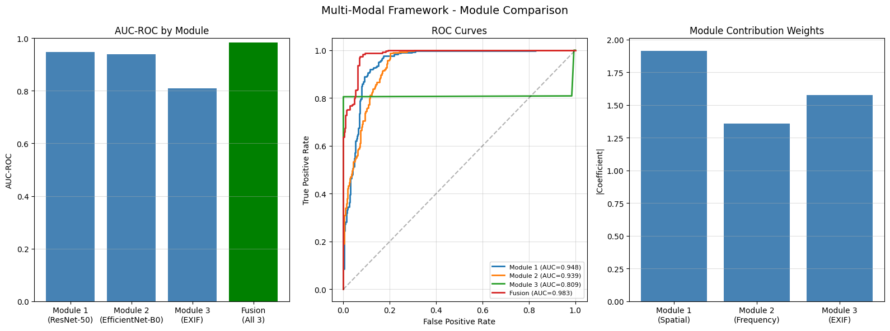
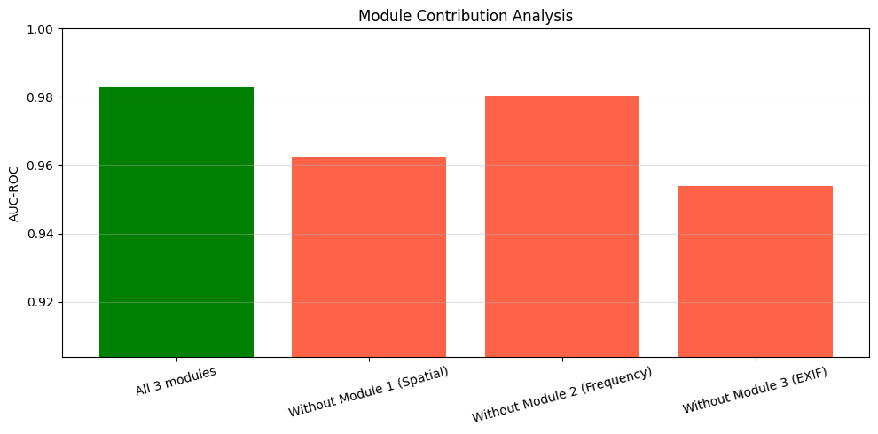
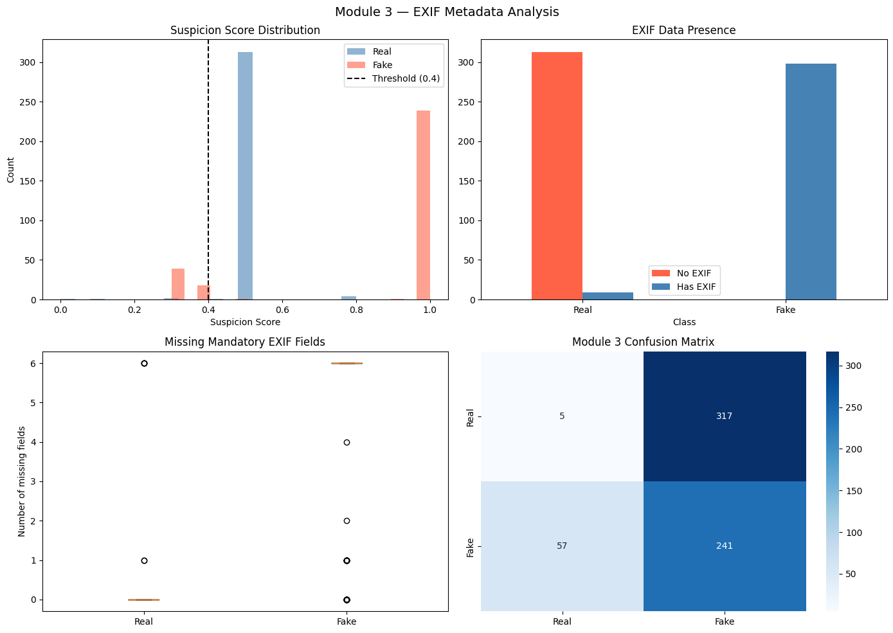

# Fake Image Detection for Digital Forensic Investigation

MSc dissertation (University of Hull, graded 82%). A multi-modal system that detects manipulated images by combining three independent forensic signals: pixel-level artefacts, frequency-domain patterns and file metadata. A logistic regression fusion layer combines them.



## Results

Test set: 620 images (322 real, 298 fake), never seen during training or tuning.

| Module | Input | Accuracy | AUC-ROC |
|---|---|---|---|
| Module 1: ResNet-50 | Error Level Analysis (ELA) maps | 89.0% | 0.948 |
| Module 2: EfficientNet-B0 | DFT magnitude spectrograms | 87.4% | 0.939 |
| Module 3: rule-based parser | EXIF metadata | 39.7% | 0.809 |
| **Fusion (logistic regression)** | All three scores | **94.4%** | **0.983** (5-fold CV) |

> **Read this with the dataset-bias check below.** Part of these headline scores comes from differences in image *source*, not manipulation. On real and fake images from the same source, the fused model scores **0.923 AUC**.

**Why EXIF accuracy is low but AUC is reasonable:** the decision threshold (0.4) sits below the score given to images with no EXIF data (0.5). Most genuine video frames have no EXIF, so nearly all of them were flagged as fake at that threshold, even though the scores still rank images reasonably well (AUC 0.809). Calibrating this threshold is listed under next steps.

**Ablation study:** removing the EXIF module caused the largest drop in fusion AUC (−0.029), more than removing either CNN, despite EXIF having the weakest standalone score.



## Key finding: testing for dataset bias

After submission, I checked whether the models detect **manipulation** or simply the **source** of each image. That check revealed an important limitation.

**The issue.** In the run shown, the Celeb-DF fake frames failed to load (see the data preparation output), so:
- all 298 fake test images are CASIA v2 tampered photos;
- 248 of the 322 real test images (77%) are Celeb-DF video frames, and 74 are CASIA v2 authentic photos.

A model could therefore score well by telling video frames apart from photos, without detecting manipulation at all. The EXIF analysis makes this visible: almost every real image has no EXIF data (video frames), while every fake does (CASIA photos).



**The check.** I re-scored every module on the CASIA images alone (74 authentic vs 298 tampered), where real and fake share the same source:

| Module | AUC, all test images | AUC, same source only (CASIA) |
|---|---|---|
| ResNet-50 (ELA) | 0.948 | 0.790 |
| EfficientNet-B0 (DFT) | 0.939 | 0.736 |
| EXIF parser | 0.809 | 0.816 |
| **Fusion** (5-fold CV)* | **0.982** | **0.923** |

*For this check, fusion AUC is computed from pooled out-of-fold predictions (0.982), which differs slightly from the mean of per-fold AUCs reported above (0.983).

**What it shows.**
- **Both CNNs drop sharply on same-source data**, so part of their headline performance came from source differences rather than manipulation artefacts.
- **The EXIF module holds up (0.816).** Within CASIA, tampered images still carry metadata traces of editing and re-saving, a genuine forensic signal.
- **Fusion still reaches 0.923 on same-source images.** Combining complementary signals helps, at a more realistic level than the headline 0.983.
- The same-source test includes only 74 authentic images, so these figures carry some uncertainty.

**Lesson.** In forensic machine learning, a high score isn't enough. You have to confirm the model has learned the intended signal, not a shortcut in how the dataset was assembled.

## How it works

```
Image ──┬─► Error Level Analysis ──► ResNet-50 (transfer learning) ──► P(fake) ─┐
        ├─► 2D DFT spectrogram ────► EfficientNet-B0 ──────────────────► P(fake) ─┼─► Logistic regression ─► Final score
        └─► EXIF metadata ─────────► Rule-based suspicion score ────────► score ───┘
```

- **ELA:** re-saves each image as JPEG at quality 90 and amplifies the difference. Edited regions often recompress differently.
- **DFT:** converts each image to the frequency domain. Manipulation and resampling leave periodic traces that show up in the spectrum.
- **EXIF:** scores suspicion from missing camera fields, a missing capture timestamp, editing-software signatures and absent metadata.
- **Fusion:** standardised module scores feed a logistic regression, tuned with 5-fold cross-validation on the held-out test predictions.

## Data

- **Real:** Celeb-DF v2 real video frames and CASIA v2.0 authentic images
- **Fake:** CASIA v2.0 tampered images (see the limitation above)
- **Balanced** by random undersampling to 2,064 images per class (JPEG/PNG only)
- **Split** 70/15/15 into train, validation and test (seed 42), with the same split indices used by every module to prevent leakage

The datasets aren't included, because of their size and licence terms. They are available from their original sources: [Celeb-DF](https://github.com/yuezunli/celeb-deepfakeforensics) and CASIA v2.0.

## Notebooks

| Notebook | What it does |
|---|---|
| [01_data_preparation](notebooks/01_data_preparation.ipynb) | Copies data, balances classes, computes ELA and DFT maps, saves shared split indices |
| [02_module1_resnet50_ela](notebooks/02_module1_resnet50_ela.ipynb) | Hyperparameter search, training with early stopping and evaluation of ResNet-50 on ELA maps; Grad-CAM |
| [03_module2_efficientnet_dft](notebooks/03_module2_efficientnet_dft.ipynb) | The same for EfficientNet-B0 on DFT spectrograms |
| [04_module3_exif_fusion](notebooks/04_module3_exif_fusion.ipynb) | EXIF parser, fusion classifier, ablation study and forensic report |

The notebooks were built for Google Colab with data stored in Google Drive. Sample-image outputs (Grad-CAM overlays and example frames) were removed before publishing, because they show images from licensed research datasets.

## Next steps

- Include Celeb-DF fake frames so both classes contain both sources, and balance the split by source.
- Evaluate across datasets (train on one, test on another) to measure generalisation.
- Recalibrate the EXIF rules and decision threshold. They currently treat missing metadata as suspicious, even though most genuine video frames have none.
- Train the fusion layer on validation-set predictions and keep the test set purely for final scoring.

## Tools

Python · PyTorch · torchvision · timm · scikit-learn · Pillow · OpenCV · ExifRead · pytorch-grad-cam · pandas · Matplotlib · Google Colab
